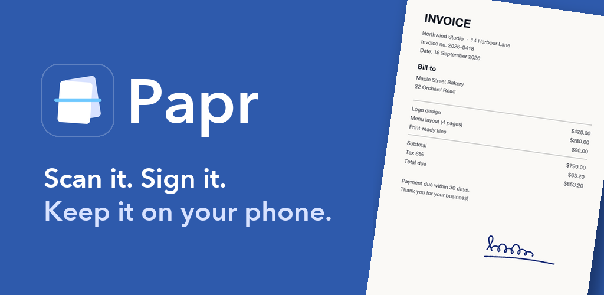
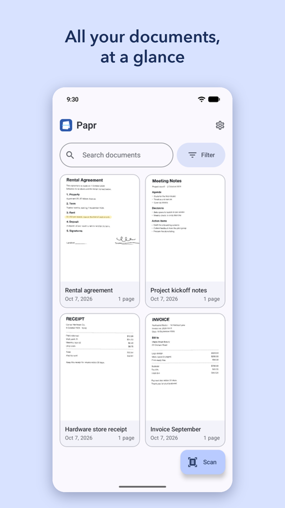
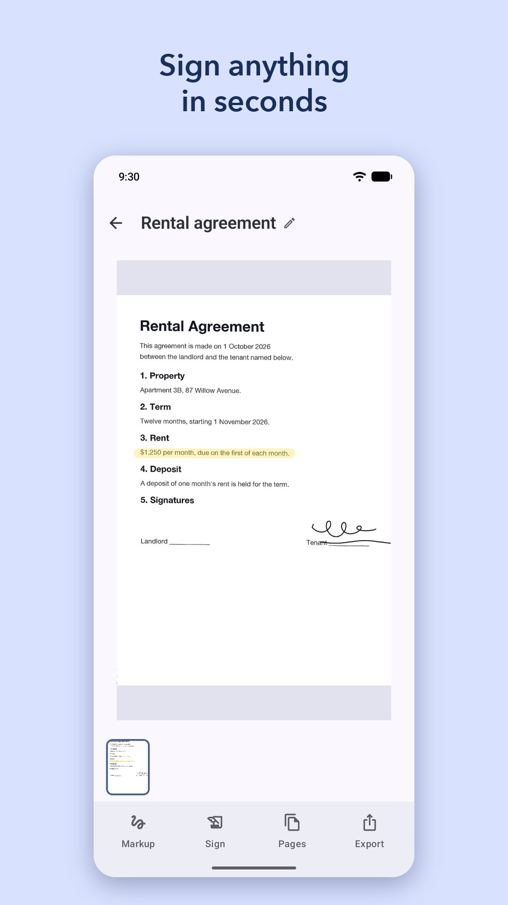
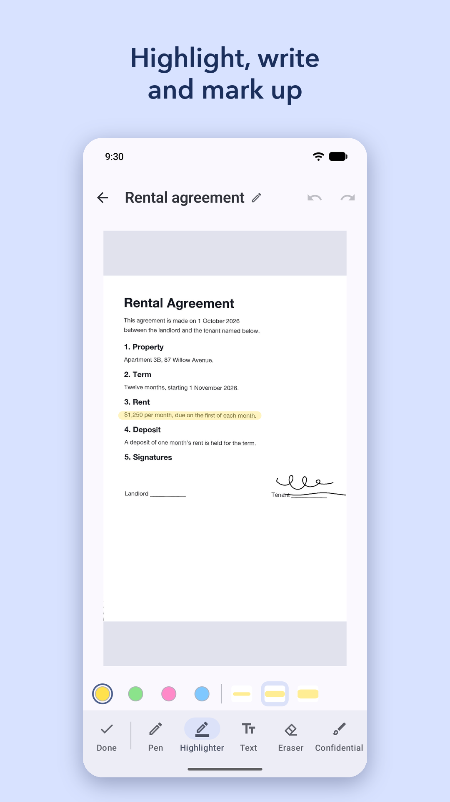
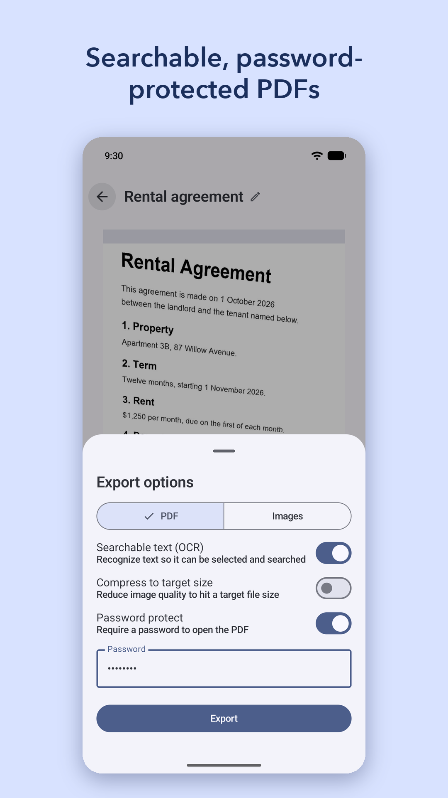
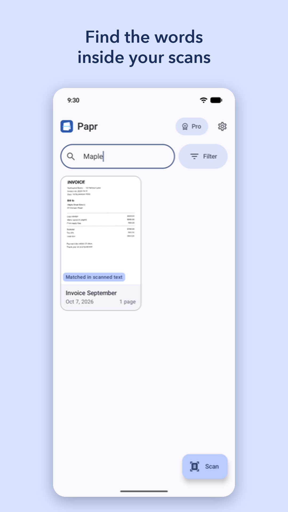
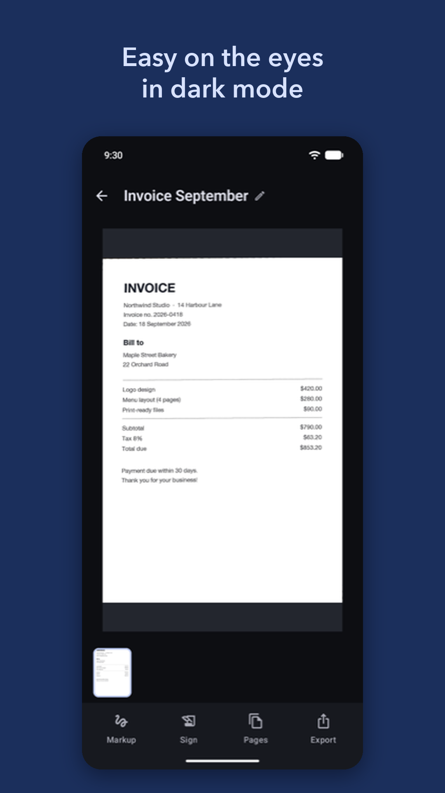
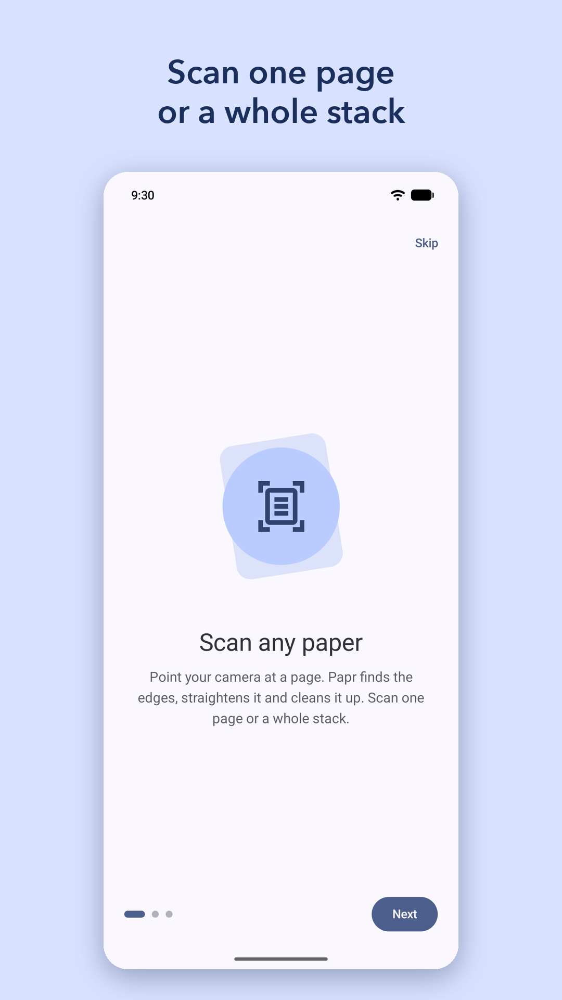

<p align="center">
  
</p>

# Papr

A free, open-source document scanner for Android. Scan paper, make it searchable, sign it, mark it up and share it as a PDF. No account, no ads, no tracking, no paid tier. Your documents stay on your phone.

**[Download the latest APK](https://github.com/AryanKingSir/Papr/releases/latest)** · Android 7.0 or newer, with Google Play services

<p align="center">
  
  
  
  
</p>
<p align="center">
  
  
  
</p>

## Features

- **Scan:** find the edges, straighten and clean up one page or a whole stack, or import photos from the gallery.
- **Search everything:** text in scans is recognised on the device, so search matches document titles and the words on the page. You can also filter by date and folder.
- **Sign:** draw a signature, drag it into place and resize it. Save one to reuse.
- **Mark up:** pen, highlighter, text boxes and an eraser, with colours, sizes, undo and redo.
- **Confidential marks:** cover sensitive content. It's removed from the pixels and the text layer of the exported file, not just hidden.
- **Organise pages:** add, replace, reorder by dragging, rotate and delete.
- **Merge** several documents into one.
- **Export:**
  - a PDF with selectable, searchable text
  - an optional password (standard 128-bit RC4, so every PDF reader can open it)
  - optional compression to a target file size
  - or each page as a JPG
- **Looks at home:** Material You colours from your wallpaper, light and dark themes, and haptics you can turn off.

Everything is free and unlimited.

## Privacy

- Papr has no accounts, no ads and no analytics or crash reporting.
- Your documents are stored only in the app's private storage on your phone and are never uploaded.
- Scanning and text recognition use Google's ML Kit, which runs on the device through Google Play services. Google may collect diagnostic and usage data about ML Kit under [its own terms](https://developers.google.com/ml-kit/terms).

## Build from source

You need Android Studio (recent enough for Android Gradle Plugin 9.5) or JDK 17 or newer with the Android SDK.

```sh
git clone https://github.com/AryanKingSir/Papr.git
cd Papr
./gradlew assembleDebug   # app/build/outputs/apk/debug/app-debug.apk
```

Release builds (`./gradlew assembleRelease`) are minified. They're signed with your own key if you copy `keystore.properties.example` to `keystore.properties` and fill it in, and with the debug key if you don't.

Run the checks before sending a change:

```sh
./gradlew :app:testDebugUnitTest :app:lintDebug
```

## How it's built

- **UI:** Kotlin, Jetpack Compose and Material 3.
- **Storage:** Room for documents and pages, DataStore for settings.
- **Scanning and OCR:** ML Kit Document Scanner and Text Recognition, through Google Play services.
- **PDF writing:** Papr's own code under `pdf/`, with no third-party PDF library. It handles the page images, the invisible OCR text layer, overlays and password encryption.
- **Other libraries:** Coil for images, Reorderable for drag-to-reorder, and coroutines.
- **Dependencies** are passed by hand through `di/AppContainer.kt`, with no DI framework.

## Contributing

Bug reports, ideas and pull requests are welcome. See [CONTRIBUTING.md](CONTRIBUTING.md).

## License

Papr is free software under the [GNU General Public License v3.0](LICENSE). You can use, study, change and share it, and anything you distribute that's based on it must stay under the same license, with its source available.

Copyright (C) 2026 AryanKingSir

**Additional permission under GNU GPL version 3 section 7:** If you modify this Program, or any covered work, by linking or combining it with Google Play services, Google ML Kit or other libraries from the Android SDK and Google's Maven repository that are not under a GPL-compatible license (or modified versions of those libraries), the licensors of this Program grant you additional permission to convey the resulting work.

Because of those proprietary Google libraries, Papr needs Google Play services and can't be listed on F-Droid.
